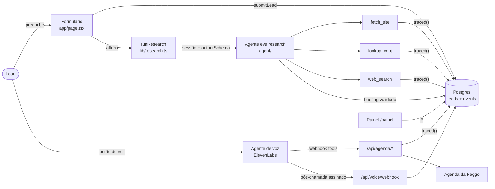
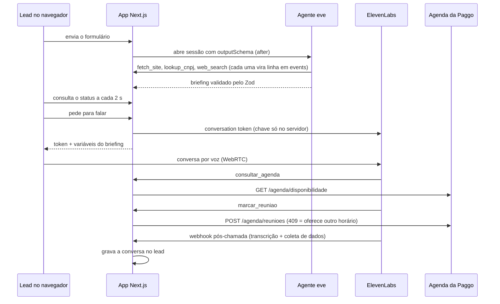

# Arquitetura

Um app Next.js no Vercel, dois agentes e duas tabelas. As peças só se falam por dois contratos: o briefing (o que a pesquisa entrega) e o registro do lead com o rastro (o que o painel lê). Com os dois fixos, cada peça troca de falsa para real sem mexer nas outras.

## Índice

- [Visão geral](#visão-geral)
- [Uma conversa, passo a passo](#uma-conversa-passo-a-passo)
- [Contratos](#contratos)
- [Mapa de arquivos](#mapa-de-arquivos)
- [Variáveis de ambiente](#variáveis-de-ambiente)

## Visão geral

Por que a voz fica fora do eve: o eve não fala, e passar a fala por ele só somaria latência. O ElevenLabs resolve turnos, interrupções e áudio; nosso backend entra só onde há ferramenta, e toda ferramenta passa por `traced()`.

## Uma conversa, passo a passo

O lead nunca toca a agenda nem a chave do ElevenLabs. As setas que entram no app Next.js são as que viram linha no rastro.

## Contratos

### Briefing (`lib/briefing.ts`)

Um schema Zod só, usado em três lugares: o `outputSchema` da sessão do eve (o resultado é validado antes de ser salvo), as variáveis da voz e a aba Pesquisa do painel.

Cada fato é `{ value, source, confidence }`: o valor, a URL de onde veio (ou `null`) e a confiança (`alta`, `media`, `baixa`). Um fato sem fonte é "não encontrado", nunca um chute.

| Bloco | Campos |
| --- | --- |
| `company` | `legalName`, `cnpj`, `segment`, `size`, `taxRegime`, `groupEntities`, `location` |
| `person` | `role`, `isPartner` |
| `fit` | `level` (`alto`, `medio`, `baixo`, `desconhecido`) e `reasons[]` |
| `spicedHypotheses` | `situation`, `pain`, `impact`, `criticalEvent`, `decision` (hipóteses, não evidência) |
| `openQuestions` | O que a voz precisa perguntar |
| `forAgent` | Até 8 linhas de texto: vira a variável `{{briefing}}` da voz |

### Registro do lead (`db/schema.sql`, `lib/leads.ts`)

| Tabela | Uma linha por | Colunas principais |
| --- | --- | --- |
| `leads` | Visitante | `form` (jsonb, como digitado), `status` (`researching`, `ready`, `failed`, `talked`), `research_run_id`, `briefing` (jsonb), `voice_run_id`, `conversation` (jsonb: transcrição, resumo, SPICED, resultado, dados confirmados), `error` |
| `events` | Chamada de ferramenta | `lead_id`, `run_kind` (`research` ou `voice`), `run_id`, `tool`, `input`, `output`, `sources` (URLs achadas na saída), `ok`, `error`, `ms` |

### Rastro (`lib/trace.ts`)

`traced(run, tool, input, fn)` roda a ferramenta, mede o tempo e grava uma linha em `events`, com sucesso ou erro. É a única regra do rastro: vale para as tools do eve e para as rotas que a voz chama. Na pesquisa, o id da execução é o id da sessão do eve e o lead é ligado depois (`linkRunToLead`); na voz, o lead vem no corpo da chamada.

## Mapa de arquivos

O estado de cada parte (provado ou não) fica em [STATUS.md](STATUS.md).

| Caminho | O que faz |
| --- | --- |
| `app/page.tsx`, `app/actions.ts` | Formulário do lead; `submitLead` valida, cria o lead, roda a pesquisa em `after()` e redireciona |
| `app/l/[id]/` | Tela de espera: consulta o status a cada 2 s e abre a conversa de voz pelo SDK do ElevenLabs |
| `app/api/leads/[id]/route.ts` | Status do lead para a tela de espera |
| `app/api/leads/[id]/voice/route.ts` | Gera o conversation token e as variáveis do briefing; só responde depois da pesquisa |
| `app/api/agenda/[action]/route.ts` | `consultar` e `marcar`, chamadas pelo agente de voz com `x-tool-secret`, dentro de `traced()` |
| `app/api/voice/webhook/route.ts` | Pós-chamada: confere a assinatura HMAC e grava a conversa no lead |
| `app/painel/` | Lista de leads e detalhe em 5 abas (Formulário, Pesquisa, Conversa estruturada, Transcrição, Rastro) |
| `app/layout.tsx`, `app/logo.tsx`, `app/theme-toggle.tsx` | Cabeçalho com o logo da Paggo e o interruptor de tema |
| `app/paggo.css`, `app/app.css` | Tokens e componentes da Paggo; o que é só deste app ([design.md](design.md)) |
| `proxy.ts` | Senha do painel por basic auth (`PANEL_PASSWORD`) |
| `agent/agent.ts`, `agent/channels/eve.ts` | Agente eve (Claude Sonnet 5.5, raciocínio baixo, só as 3 tools) e a auth do canal (OIDC do Vercel em produção, livre em dev) |
| `agent/instructions.md` | Ordem da pesquisa, regras de fit, formato do `forAgent`, nunca inventar |
| `agent/tools/` | `fetch_site`, `lookup_cnpj`, `web_search`, cada uma dentro de `traced()` |
| `evals/` | Eval do eve com os 6 casos difíceis ([research-cases.md](research-cases.md)) |
| `lib/cnpj.ts`, `lib/site.ts`, `lib/search.ts` | Receita pela BrasilAPI, leitura do site, busca na Exa |
| `lib/briefing.ts`, `lib/research.ts` | Schema do briefing; abre a sessão do eve e salva o resultado |
| `lib/voice.ts` | Assinatura do webhook e conversão do pós-chamada para o registro do lead |
| `lib/agenda.ts` | Interface da agenda: real (com URL e token) ou falsa |
| `lib/trace.ts`, `lib/leads.ts`, `lib/db.ts` | Rastro, leitura e escrita dos leads, conexão |
| `db/schema.sql`, `scripts/db-setup.mjs` | Tabelas, criadas antes de cada build |
| `voice/` | Agente de voz: `prompt.md`, `agent.json`, `tools/` e as personas de teste |
| `scripts/voice-sync.mjs`, `scripts/voice-simulate.mjs` | Publica o agente numa conta do ElevenLabs; conversa por texto com uma persona e mede a transcrição |

## Variáveis de ambiente

Modelo em `.env.example`. Em produção, só nas variáveis do projeto no Vercel.

| Variável | Para quê | Sem ela |
| --- | --- | --- |
| `DATABASE_URL` | Postgres | O app não abre o painel nem salva leads |
| `ANTHROPIC_API_KEY` | Modelo do agente de pesquisa (Claude Sonnet 5.5, chamada direta) | A pesquisa falha e o lead fica como "failed" |
| `EXA_API_KEY` | Busca web da pesquisa | `web_search` falha e o agente segue com site e Receita |
| `AGENDA_URL`, `AGENDA_TOKEN` | Agenda real da Paggo | Usa a agenda falsa |
| `ELEVENLABS_API_KEY`, `ELEVENLABS_AGENT_ID` | Token da conversa de voz | Sem voz |
| `VOICE_TOOL_SECRET` | Segredo que as ferramentas da agenda exigem no cabeçalho `x-tool-secret` | As rotas da agenda recusam tudo |
| `ELEVENLABS_WEBHOOK_SECRET` | Confere a assinatura do pós-chamada | O webhook recusa tudo e a conversa não é gravada |
| `PANEL_PASSWORD` | Senha do painel | Painel aberto (só para dev local) |
| `EVE_HOST` | Endereço do eve no dev local quando o servidor não está na porta 3000 | Usa `http://localhost:3000` |

O modelo do agente eve é chamado direto na Anthropic com `ANTHROPIC_API_KEY` (helper `anthropic()` do eve). O AI Gateway com OIDC exigiria crédito pago para essa classe de modelo.
