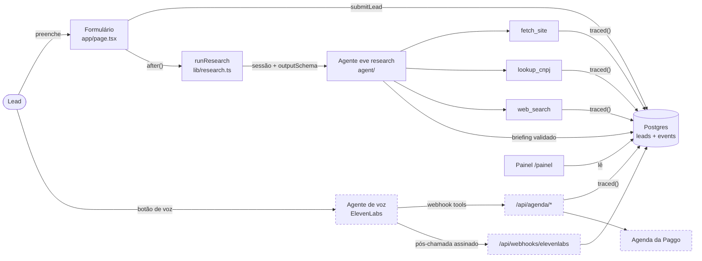
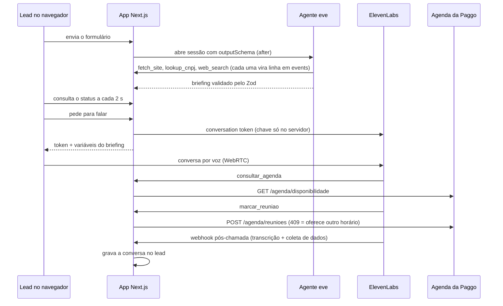

# Arquitetura

Um app Next.js no Vercel, dois agentes e duas tabelas. As peças só se falam por dois contratos: o briefing (o que a pesquisa entrega) e o registro do lead com o rastro (o que o painel lê). Com os dois fixos, cada peça troca de falsa para real sem mexer nas outras.

## Índice

- [Visão geral](#visão-geral)
- [Uma conversa, passo a passo](#uma-conversa-passo-a-passo)
- [Contratos](#contratos)
- [Mapa de arquivos](#mapa-de-arquivos)
- [Variáveis de ambiente](#variáveis-de-ambiente)

## Visão geral

Tracejado = ainda não construído (marcos 3 e 4 do [STATUS.md](STATUS.md)).

Por que a voz fica fora do eve: o eve não fala, e passar a fala por ele só somaria latência. O ElevenLabs resolve turnos, interrupções e áudio; nosso backend entra só onde há ferramenta, e toda ferramenta passa por `traced()`.

## Uma conversa, passo a passo

O lead nunca toca a agenda nem a chave do ElevenLabs. As setas que entram no app Next.js são as que viram linha no rastro.

## Contratos

### Briefing (`lib/briefing.ts`)

Um schema Zod só, usado em três lugares: o `outputSchema` da sessão do eve (o resultado é validado antes de ser salvo), as variáveis da voz e a aba Pesquisa do painel.

Cada fato é `{ value, source, confidence }`: o valor, a URL de onde veio (ou `null`) e a confiança (`alta`, `media`, `baixa`). Um fato sem fonte é "não encontrado", nunca um chute.

| Bloco | Campos |
| --- | --- |
| `company` | `legalName`, `cnpj`, `segment`, `size`, `taxRegime`, `groupEntities`, `location` |
| `person` | `role`, `isPartner` |
| `fit` | `level` (`alto`, `medio`, `baixo`, `desconhecido`) e `reasons[]` |
| `spicedHypotheses` | `situation`, `pain`, `impact`, `criticalEvent`, `decision` (hipóteses, não evidência) |
| `openQuestions` | O que a voz precisa perguntar |
| `forAgent` | Até 8 linhas de texto: vira a variável `{{briefing}}` da voz |

### Registro do lead (`db/schema.sql`, `lib/leads.ts`)

| Tabela | Uma linha por | Colunas principais |
| --- | --- | --- |
| `leads` | Visitante | `form` (jsonb, como digitado), `status` (`researching`, `ready`, `failed`, `talked`), `research_run_id`, `briefing` (jsonb), `voice_run_id`, `conversation` (jsonb: transcrição, resumo, SPICED, resultado, dados confirmados), `error` |
| `events` | Chamada de ferramenta | `lead_id`, `run_kind` (`research` ou `voice`), `run_id`, `tool`, `input`, `output`, `sources` (URLs achadas na saída), `ok`, `error`, `ms` |

### Rastro (`lib/trace.ts`)

`traced(run, tool, input, fn)` roda a ferramenta, mede o tempo e grava uma linha em `events`, com sucesso ou erro. É a única regra do rastro: vale para as tools do eve e para as rotas que a voz chama. Na pesquisa, o id da execução é o id da sessão do eve e o lead é ligado depois (`linkRunToLead`); na voz, o lead vem no corpo da chamada.

## Mapa de arquivos

| Caminho | O que faz | Estado |
| --- | --- | --- |
| `app/page.tsx` | Formulário do lead | Pronto |
| `app/actions.ts` | `submitLead`: valida, cria o lead, roda a pesquisa em `after()` e redireciona | Pronto |
| `app/l/[id]/` | Tela de espera; consulta o status a cada 2 s; botão "Falar com a Paggo" | Botão desativado até o marco 3 |
| `app/api/leads/[id]/route.ts` | Status do lead para a tela de espera | Pronto |
| `app/painel/` | Lista de leads e detalhe em 5 abas (Formulário, Pesquisa, Conversa estruturada, Transcrição, Rastro) | Pronto, sem dados reais ainda |
| `proxy.ts` | Senha do painel por basic auth (`PANEL_PASSWORD`) | Pronto |
| `agent/agent.ts` | Modelo do agente eve, raciocínio baixo, sem tools padrão | Pronto |
| `agent/instructions.md` | Ordem da pesquisa, regras de fit, nunca inventar | Pronto, a ajustar com empresas reais |
| `agent/tools/` | `fetch_site`, `lookup_cnpj`, `web_search`, cada uma com `traced()` | Pronto |
| `agent/channels/eve.ts` | Auth do canal: OIDC do Vercel em produção, livre em dev | A provar no primeiro deploy |
| `lib/cnpj.ts` | CNPJ alfanumérico, mod 11, consulta à BrasilAPI | Pronto, 6 testes |
| `lib/site.ts` | Lê home e páginas de contato do domínio do e-mail; acha CNPJs | Pronto |
| `lib/search.ts` | Busca web na Exa | Pronto, sem chave ainda |
| `lib/research.ts` | Abre a sessão do eve e salva o briefing | Pronto |
| `lib/agenda.ts` | Interface da agenda: real (com URL e token) ou falsa | Falsa ativa |
| `lib/trace.ts`, `lib/leads.ts`, `lib/db.ts` | Rastro, leitura e escrita dos leads, conexão | Pronto |
| `db/schema.sql`, `scripts/db-setup.mjs` | Tabelas, criadas antes de cada build | Pronto |
| `voice/` | Config do agente de voz para a CLI do ElevenLabs | Marco 3 |
| `app/api/voice/[id]/route.ts` | Gera o conversation token e as variáveis do briefing | Marco 3 |
| `app/api/agenda/[action]/route.ts` | `consultar` e `marcar`, chamadas pelo ElevenLabs | Marco 4 |
| `app/api/webhooks/elevenlabs/route.ts` | Pós-chamada: verifica a assinatura e grava a conversa | Marco 4 |

## Variáveis de ambiente

Modelo em `.env.example`. Em produção, só nas variáveis do projeto no Vercel.

| Variável | Para quê | Sem ela |
| --- | --- | --- |
| `DATABASE_URL` | Postgres | O app não abre o painel nem salva leads |
| `EXA_API_KEY` | Busca web da pesquisa | `web_search` falha e o agente segue com site e Receita |
| `AGENDA_URL`, `AGENDA_TOKEN` | Agenda real da Paggo | Usa a agenda falsa |
| `ELEVENLABS_API_KEY`, `ELEVENLABS_AGENT_ID` | Token da conversa de voz | Sem voz |
| `PANEL_PASSWORD` | Senha do painel | Painel aberto (só para dev local) |

O modelo do agente eve passa pelo AI Gateway da Vercel com o token OIDC do projeto, sem chave no código.
